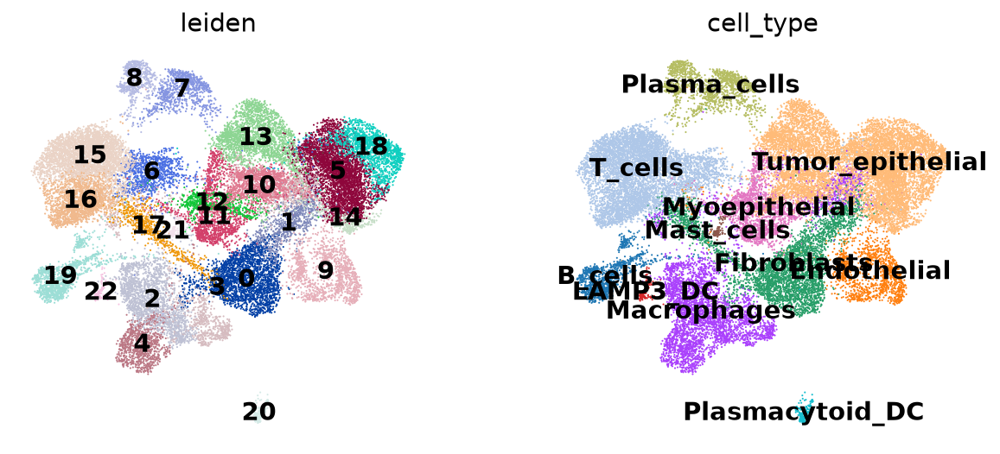

# Mapping a breast tumour by combining single-cell and spatial transcriptomics

A reproducible **Nextflow** pipeline that integrates **scRNA-seq** (10x Chromium Flex, FFPE) and **Visium CytAssist** spatial transcriptomics from **the same tumour block**, to estimate the cell-type composition of every spot of the tissue section.



## Question

Visium spots are 55 µm wide and usually contain 5 to 20 cells, so each spot measures a mixture. Using single-cell data from the same tissue as a reference, can we locate **tumour cells, stroma and immune cells** on the section, and relate **spatial domains** to their cellular composition?

## Data

Public data from Janesick et al., *High resolution mapping of the tumor microenvironment using integrated single-cell, spatial and in situ analysis*, Nature Communications 2023 (GEO GSE243280): one FFPE breast cancer block profiled on adjacent sections.

| dataset | technology | size |
|---|---|---|
| single-cell | Chromium Flex (probe-based, fixed RNA) | 30,365 cells × 18,082 genes |
| spatial | Visium CytAssist (FFPE) | 4,992 spots × 18,085 genes, with H&E image |
| labels | cell annotations published by 10x | used only to check the analysis |

Both technologies use the same human probe panel, so all 18,082 single-cell genes are also measured in the spatial data.

## Approach

The analysis is first explored step by step in notebooks, then turned into a Nextflow pipeline (in development) where each step runs in its own Docker container:

```
QC_SC ──> ANNOTATE_SC ──┐
                        ├──> DECONVOLVE_RCTD ──> REPORT
QC_SPATIAL ─────────────┘
```

| step | tools | what it does |
|---|---|---|
| `QC_SC` | Scanpy, Scrublet | QC metrics, cell filtering, doublet detection |
| `ANNOTATE_SC` | Scanpy | normalisation, PCA, UMAP, Leiden clustering, marker-based annotation, comparison with the published labels |
| `QC_SPATIAL` | Squidpy | spot QC, clustering, spatially variable genes (Moran's I) |
| `DECONVOLVE_RCTD` | R, spacexr (RCTD) | proportion of each cell type in each spot |
| `REPORT` | Squidpy, Matplotlib | cell-type proportion maps, composition of each spatial domain |

## Running the notebooks

```bash
# 1. Environment (WSL2/Ubuntu or Linux, no root access needed):
#    Miniforge, then the "scspatial-python" conda environment from envs/python.yml
bash scripts/setup_wsl.sh

# 2. Data (~170 MB) into data/
bash scripts/download_data.sh
```

Then open `notebooks/01_single_cell.ipynb` with the `scspatial-python` kernel. About 10 GB of RAM are needed (Scrublet is the most demanding step).

## Results

### Single-cell quality control and annotation (`notebooks/01_single_cell.ipynb`)

- **QC thresholds chosen from the data**: ≥ 300 detected genes and ≤ 15 % mitochondrial counts. A 10 % cut-off was rejected after checking which cells it removed: invasive tumour cells have a higher baseline mitochondrial fraction (median 3.9 % vs 1.1-1.4 % for T cells, macrophages and stroma), and those between 10 and 15 % have *more* detected genes than the others, a sign of active rather than damaged cells.
- **Doublets**: Scrublet's automatic threshold would have removed 22 % of the cells (the score distribution has no second mode). A conservative threshold (0.18, 2.4 % of cells) was combined with a cluster-level review: three clusters (2,413 cells) were flagged as doublets from their median doublet score, their overlap with the hybrid cells annotated by 10x, and their two-cell-type marker profiles. One of them (fibroblast + tumour) has no equivalent category in the published labels.
- **Annotation**: 23 Leiden clusters annotated with a curated marker list ([`assets/MARKERS.md`](assets/MARKERS.md)) into 12 cell types, including two dendritic cell populations (plasmacytoid and LAMP3+) and plasma cells, which the published labels group with B cells. Tumour clusters carry the co-expression signature of the **ERBB2 (HER2) amplicon** on chromosome 17.
- **Agreement with the published labels**: 80-100 % per label; differences are mainly in granularity (CD4/CD8 T cells, DCIS vs invasive tumour are not separated).

### Spatial domains and deconvolution

Work in progress: Visium spot QC and spatial domains, then RCTD deconvolution with the annotated single-cell data as reference, and the Nextflow pipeline.

## Limitations

- Annotation relies on a marker list with one tumour type: DCIS and invasive tumour cells are not distinguished, and perivascular cells are merged with endothelial cells.
- The published labels helped select the markers, so the comparison with these labels is not fully independent.
- A single sample; the analysis starts from the Cell Ranger / Space Ranger count matrices (no FASTQ processing).
- Next steps: Xenium in situ data from the same block, copy-number inference to separate tumour from normal epithelial cells.

## Environment

Python 3.11 (Scanpy 1.11, Squidpy 1.8), see `envs/python.yml`. Pipeline: Nextflow ≥ 24.04, Docker, R 4.4 (spacexr). Tested on Windows 11 with WSL2 (Ubuntu).

## References

- Janesick A. et al. High resolution mapping of the tumor microenvironment using integrated single-cell, spatial and in situ analysis. *Nat Commun* 2023.
- Wolf F.A., Angerer P., Theis F.J. SCANPY: large-scale single-cell gene expression data analysis. *Genome Biol* 2018.
- Palla G. et al. Squidpy: a scalable framework for spatial omics analysis. *Nat Methods* 2022.
- Wolock S.L., Lopez R., Klein A.M. Scrublet: computational identification of cell doublets in single-cell transcriptomic data. *Cell Syst* 2019.
- Cable D.M. et al. Robust decomposition of cell type mixtures in spatial transcriptomics. *Nat Biotechnol* 2022.
- Di Tommaso P. et al. Nextflow enables reproducible computational workflows. *Nat Biotechnol* 2017.
- Wu S.Z. et al. A single-cell and spatially resolved atlas of human breast cancers. *Nat Genet* 2021.
